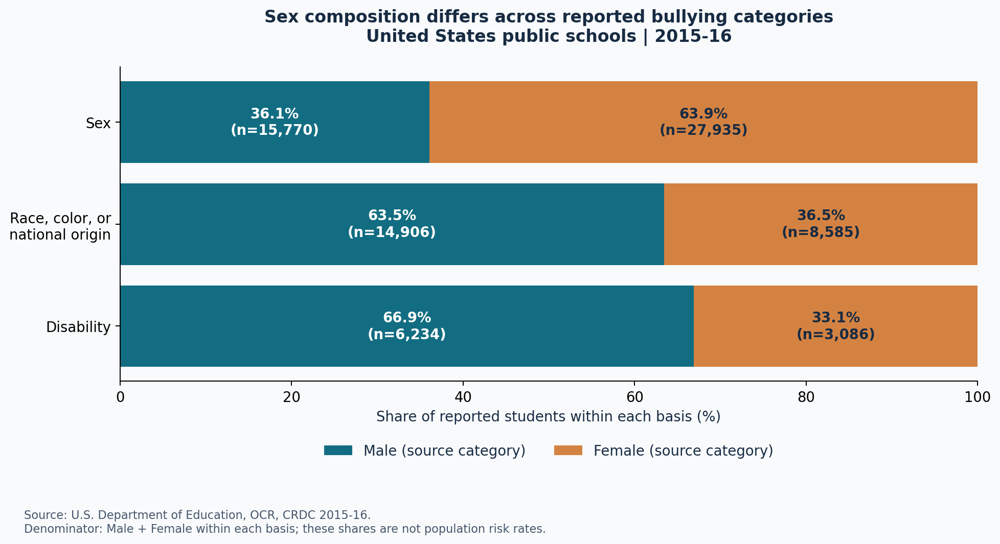

CISC7204 · DATA SCIENCE PORTFOLIO

# Li Linye

This portfolio presents a coursework project exploring public education data. It connects reproducible Python analysis with clear visual explanations and careful interpretation of the limits of administrative records.

**Technical skills demonstrated in this project:** Python · pandas · NumPy · Excel data cleaning · data validation · Matplotlib · reproducible documentation.

---

## Project showcase

### Understanding harassment and bullying in U.S. public schools

**Research question:** How did reported harassment and bullying vary by basis in 2015–16, and how did the sex composition of reported students differ across categories?

**Project status:** Completed — local analysis and documentation. Website publication and peer feedback are pending.

[View the project repository on GitHub](https://github.com/mc65222/data-science-project)

### Finding 01 · Sex-based allegations were the largest category

Among **135,192** national allegations, **55,579 (41.1%)** were sex-based. Race, color, or national origin accounted for 30,913 allegations. The unit is an allegation, not a unique student.

### Finding 02 · Two counts, two different meanings

Sex-based bullying tables record **43,705 students reported as harassed or bullied** and **50,191 students disciplined for harassment or bullying**. These are different, unlinked groups. This comparison describes two measures; it cannot show the percentage of cases resolved.

### Finding 03 · The composition changes by category

Female students account for **63.9%** of sex-based reported students. Male students account for **63.5%** of race-based and **66.9%** of disability-based reported students. Each percentage uses the reported student count for that basis as its denominator. The source's sex categories are retained.

## How the analysis works

The Python script reads seven Excel workbooks, checks 19 sheets, extracts tidy tables and creates three reproducible figures. Checks include national/state reconciliation and agreement between male, female and total counts. Original workbooks are preserved, and source hashes and software versions are recorded.

The project repository provides code, input files, package requirements, cleaned tables, a written report and README instructions for rerunning the analysis.

## What the figures cannot tell us

**Administrative reports do not measure the true prevalence of bullying.** Underreporting and differences in reporting coverage can affect the counts. The national allegations table reports 99.5% of schools reporting; some jurisdictions have lower coverage. Enrollment denominators are absent, so these figures do not establish which population faces a higher risk. Categories may overlap, and a single historical year cannot show trends or causal effects.

## Next steps

I plan to investigate reporting completeness, add compatible enrollment denominators and extend the analysis to additional years with consistent definitions. I will also ask a classmate to review the project's purpose, finding and limitation, then document one improvement.

## Data and transparency

Source: [U.S. Department of Education, Office for Civil Rights, CRDC 2015–16](https://catalog.data.gov/dataset/2015-16-harassment-or-bullying-by-basis-category-civil-rights-data-collection). The official catalog lists public access and a CC BY license. These figures are derived from the supplied aggregate workbooks.

AI assistance: OpenAI Codex helped draft the analysis code, documentation and website source. Student review and personalization remain required before submission.
